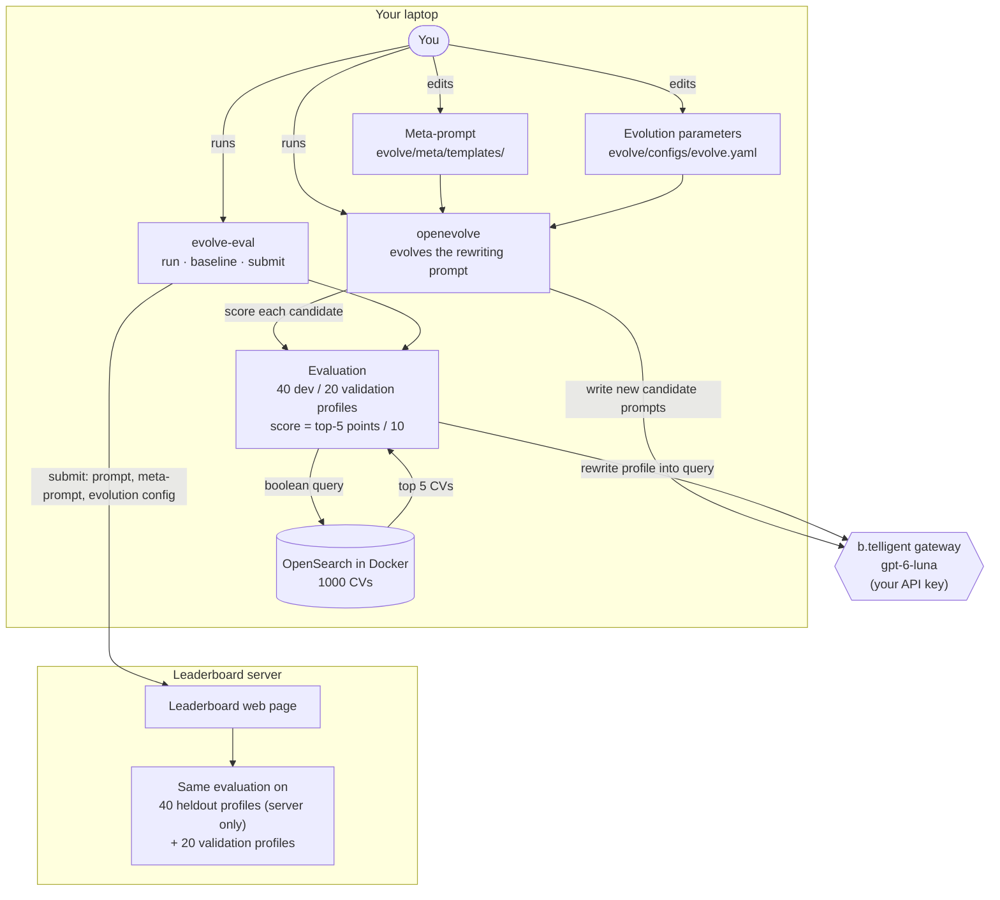

# Participant instructions

In this workshop an LLM (the query model) turns staffing requests ("search profiles") into
boolean search queries for a CV search on OpenSearch. How well that works
depends on the **rewriting prompt** the LLM gets. Instead of tuning that prompt
by hand, you let [openevolve](https://github.com/algorithmicsuperintelligence/openevolve)
evolve it: an evolution model writes new candidate prompts, each candidate is
scored on 40 search profiles, and the best ones become parents of the next
candidates. You steer the evolution through the **meta-prompt** (what the
evolution model is told) and the **evolution parameters** (how the search runs), and
compare your results on a shared leaderboard.

Two LLM roles are involved:
- The **query model** (`gpt-6-luna`, fixed) turns a search profile into a
  query, following the rewriting prompt.
- The **evolution model** (also `gpt-6-luna` by default, but this one is configurable) writes
  new rewriting prompts, following the meta-prompt.

One **iteration** of the evolution: pick a parent prompt from the population
(the prompts kept so far), let the evolution model write one new candidate,
score it on the 40 dev profiles, and add it to the population.

**Work through the sections in this order:**
1. setup (update, API key, OpenSearch), 
2. the exercises at the end. 

The sections in between are there to help you with the commands etc.

## Setup

This assumes you have done the pre-workshop checklist (`vorbereitung.md`):
Docker and uv are installed, the repository is cloned, and `uv sync` and
`docker compose pull` have run. All commands below run in the repository
folder; on Windows in the WSL terminal.

### Updating the repository

Get the latest version with `git pull` before you start. If the instructor
announces a fix during the workshop and you have already changed files, keep
your changes like this:

```bash
git stash && git pull && git stash pop
```

### Setting your API key

The workshop code talks to the b.telligent chat gateway (OpenAI-compatible). It reads the key from the
environment variable `BTELLIGENT_API_KEY`. You do **not** need to create a `.env`
file, so the key never has to be written to disk.

#### Set the key for the current shell session

```bash
read -rs BTELLIGENT_API_KEY && export BTELLIGENT_API_KEY
```

Paste the key and press Enter. The key stays in the memory of that shell only.
The `-s` flag keeps it from being echoed in the terminal.

Run all workshop commands from the same terminal. A new terminal needs the command again.

#### Notes

- If you start an editor or a coding agent (e.g. Claude Code) from the same
  terminal, it inherits the variable. Export the key first, then start the tool.
- Never commit the key. The optional `.env` file is gitignored, but the
  environment variable is the safer choice.
- If both exist, the environment variable takes precedence over `.env`.

### Starting OpenSearch

```bash
docker compose up -d --wait     # start OpenSearch
uv run evolve-eval index        # load the 1000 CVs into OpenSearch
uv run evolve-eval check        # checks OpenSearch, the index and your API key
```

`check` prints `"ok": true` when everything works. Every `evolve-eval` command
prints one JSON object; on problems it contains an `"error"` with a hint.

If you would like to develop an intuition for the data available in OpenSearch you can use [Dashboards Discover](http://localhost:5601/app/discover) to browse the CVs.

## Overview diagram



Everything above the leaderboard runs on your laptop. The leaderboard scores
your submitted prompt on 40 heldout profiles that you never see, so a prompt
that only fits the dev profiles does not win there.

## What you can do and influence

Three texts and one config file are involved. You change two of them; the
evolution changes the third.

| What | Where | Who changes it |
|---|---|---|
| Rewriting prompt | `evolve/initial_prompt.txt` (start), new versions in your run folder (`--output`, see [Evolving](#evolving-the-rewriting-prompt-and-scoring-it-afterwards)) | the evolution (you may also write your own) |
| the query model (`gpt-6-luna`) | fixed | nobody; this is a simple task, so we limit ourselves to a small model |
| Meta-prompt | `evolve/meta/templates/` | you |
| Evolution parameters, including the evolution model | `evolve/configs/evolve.yaml` | you |
| Evaluation: profiles, CVs, scoring | fixed | nobody |

**The rewriting prompt** turns one search profile into an OpenSearch query.
It is what gets scored and what you submit. The evolution starts from
`evolve/initial_prompt.txt` and writes one new version per iteration.

**The meta-prompt** is what the evolution model reads before it writes a new
rewriting prompt. It is your main lever: the evolution model knows only what
the meta-prompt tells it, plus what the evaluation reports about the parent
prompt: its score, how many profiles scored 0 or returned no CVs, and for the
4 worst and 2 best profiles the profile's requirements, the generated query
and any error. This report is the **feedback** (the `{artifacts}` placeholder
below). The evolution model also sees a few earlier prompts with their scores.
The meta-prompt consists of two files in `evolve/meta/templates/`:

- `system_message.txt`: the role and the background, i.e. how the search
  system works, how the score is computed and what to aim for. Plain text.
- `full_rewrite_user.txt`: the request for every new candidate. Before each
  call, openevolve fills in the placeholders below. openevolve was built to
  evolve code, so it calls each candidate a "program"; here, a program is a
  rewriting prompt.

  | Placeholder | Filled with |
  |---|---|
  | `{current_program}` | the rewriting prompt that is being improved (the parent) |
  | `{fitness_score}`, `{metrics}` | its score, and all measured numbers: score, profiles with 0 points, errors, prompt length, average query length |
  | `{artifacts}` | the feedback on the parent (see above) |
  | `{evolution_history}` | earlier candidates: the best ones and a few different ones, with their scores |
  | `{improvement_areas}` | short hints: whether the score went up, down or stayed the same compared with earlier versions |

How to change the meta-prompt:
- Edit the two files with any editor. Add knowledge (about the CVs, the query
  syntax, the scoring), strategies or rules; reword or drop what you think
  does not help.
- In `full_rewrite_user.txt` you may move or drop placeholders, but not invent
  new ones. Literal braces must be doubled there (`{{profile}}`), because the
  file is filled in with Python's `str.format`. `system_message.txt` has no
  placeholders, so single braces are fine.
- Keep two requirements in the request: the new rewriting prompt must contain
  `{profile}` exactly once (otherwise it cannot be scored), and the answer must
  be a single ```` ```text ```` code block (openevolve extracts the prompt from it).
- To see what the evolution model actually got: every candidate in the
  checkpoints of a run (see [Evolving](#evolving-the-rewriting-prompt-and-scoring-it-afterwards)),
  `checkpoints/checkpoint_*/programs/*.json` in the run folder, stores the filled-in
  meta-prompt and the model's answer under `"prompts"`.

**The evolution parameters** in `evolve/configs/evolve.yaml` control how the
search runs. The comments in the file explain each setting. The main groups:

| Group | Settings | What they decide |
|---|---|---|
| Evolution model | `llm.models` (name, `weight`), `llm.reasoning_effort` | which model writes the candidates, and how long it thinks before writing one (`none`, `low`, `medium`, `high`) |
| What the model sees | `prompt.num_top_programs`, `prompt.num_diverse_programs`, `prompt.include_artifacts` | how many earlier prompts appear in `{evolution_history}`, and whether `{artifacts}` contains feedback |
| Population | `max_iterations` (or `--iterations`), `database.population_size`, `num_islands`, `migration_interval`, `migration_rate` | how many new prompts a run generates in total (one per iteration, each from one parent), how many prompts are kept, and in how many separate groups that exchange their best now and then |
| Parent selection | `exploitation_ratio`, `exploration_ratio` | where the next parent comes from: with probability `exploitation_ratio` from the best prompts, with `exploration_ratio` from the current island, otherwise from all prompts |

Leave the `api_base`, `api_key`, `language`, `diff_based_evolution`, and the
`evaluator` section as they are; they make the setup work, not the search.

## Evolving the rewriting prompt and scoring it afterwards

```bash
uv run openevolve-run evolve/initial_prompt.txt evolve/evaluator.py \
    --config evolve/configs/evolve.yaml --output evolve/runs/my-run --iterations 5
```

`evolve/evaluator.py` connects openevolve to the scoring and writes the
feedback. `--output` is the run folder. Five iterations take about 3 minutes.

Every 5 iterations, openevolve saves a **checkpoint** in
`evolve/runs/my-run/checkpoints/checkpoint_N/`: the whole population, and for
each candidate its score, feedback and the meta-prompt it was made from. You
can continue a run from a checkpoint (see [Exercise 3](#exercise-3-tune-the-evolution-parameters)).

The best prompt ends up in
`evolve/runs/my-run/best/best_program.txt`. 

You can now evaluate it in more detail. The prompt was evolved on the dev data split, so you may want to evaluate it on the validation split:

```bash
uv run evolve-eval run evolve/runs/my-run/best/best_program.txt --split validation
```

Optionally, you can also add `--details`, which shows the generated query and the result for every profile.

To change how the evolution works, edit the meta-prompt or the evolution
parameters (see [What you can do and influence](#what-you-can-do-and-influence)).


## How the score works in detail

For every search profile, the rewriting prompt (with the profile inserted at
`{profile}`) goes to the query model, the answer runs as a query against the
1000 CVs, and the top 5 CVs are scored: 2 points for a very good fit, 1 point
for a reasonable fit, 0 otherwise. Whether a CV fits is decided by fixed rules
from the profile's requirements and the CV (`src/evolve_demo/labels.py`). The
score is the points divided by 10, averaged over the profiles. A query with a
syntax error or without any hits scores 0.

Not every profile has five well-fitting CVs, so even a perfect prompt stays
well below 100%: about 68% is the best reachable score.

The search profiles are in `queries/<id>.txt`, the CVs in `CVs/`. The
profiles come in three splits:
- **dev** (40 profiles): used by the evolution and by default in `evolve-eval`.
- **validation** (20 profiles): for your own check whether a prompt also works
  on profiles the evolution has not seen.
- **heldout** (40 profiles): hidden, only on the leaderboard server. Your
  leaderboard rank is based on these.

## Submitting to the leaderboard

You get the leaderboard address and the workshop token from the instructor.

```bash
export LEADERBOARD_URL=https://<address>      # from the instructor
read -rs LEADERBOARD_TOKEN && export LEADERBOARD_TOKEN
uv run evolve-eval submit evolve/runs/my-run/best/best_program.txt --name "Your Name" --wait
```

`--wait` waits until the server has scored the submission. The submission contains your rewriting prompt plus your current meta-prompt
(`evolve/meta/templates/`) and evolution config (`evolve/configs/evolve.yaml`). Others
see only your name and scores; the prompts and the config are visible to the
instructor only. The server scores the prompt on the 40 heldout profiles,
which you never see, and on the 20 validation profiles; this takes about a minute. You can submit again
once the previous submission is scored and two minutes have passed.

## Command overview

All commands on one page, for quick lookup: [command_overview.md](command_overview.md).

# Exercises

Tips for all exercises:
- Use a new `--output` folder for every run (`evolve/runs/ex1`, `evolve/runs/ex2-hints`, …)
  so you can compare runs later. Each folder keeps all candidate prompts with
  their scores and feedback in `checkpoints/`.
- Change one thing at a time; otherwise you cannot tell what helped.
- Scores vary by a point or two between identical runs, because the LLMs do
  not answer the same way every time. Do not read too much into small differences.
- Submit early and often: whenever a run gives you a prompt that looks
  better than your last submission, submit it (see
  [Submitting to the leaderboard](#submitting-to-the-leaderboard)), with the
  same `--name` each time. Preliminary results are welcome; the leaderboard
  should keep moving during the workshop. Compare its heldout score with your
  dev and validation scores each time.
- The meta-prompt and evolution config are part of your submission. Commit or copy a
  version you want to keep before you change it again.

### Exercise 0: Look at the starting point

1. Score the starting prompt with details:
   `uv run evolve-eval baseline --details > baseline.json`
2. Read `evolve/initial_prompt.txt` and a few generated queries in
   `baseline.json`. How many profiles score 0, and why? Compare a query with
   its profile in `queries/<id>.txt` and with a few CVs in `CVs/`.
3. Optional: write your own improved prompt into a file and score it with
   `uv run evolve-eval run my_prompt.txt`. Keep the score in mind for later.

### Exercise 1: Evolve with the defaults

1. Run 5 iterations with the default meta-prompt and evolution config
   (`--output evolve/runs/ex1`, about 3 minutes).
2. Read `evolve/runs/ex1/best/best_program.txt`. What did the evolution change
   compared with the starting prompt? Is it what you would have done by hand?
3. Score the best prompt on validation. Is the score close to the dev score?
4. Submit it to the leaderboard so you have a first entry.

### Exercise 2: Improve the meta-prompt

The evolution model only knows what `evolve/meta/templates/system_message.txt`
and `full_rewrite_user.txt` tell it, plus the feedback described in
[What you can do and influence](#what-you-can-do-and-influence).
Think about what it does **not** know:
- What does a CV document in the index look like, which fields does it have,
  and which query syntax does OpenSearch accept? (See `CVs/` and
  `src/evolve_demo/opensearch.py`.)
- When exactly does a CV count as a very good or a reasonable fit? (See
  `src/evolve_demo/labels.py`.)
- Which parts of a search profile matter for the score, and which do not?

Add what you think helps to the meta-prompt, run again with a new output
folder (5–10 iterations), and compare with exercise 1 on dev and validation.
Remember that `full_rewrite_user.txt` is filled in with Python's
`str.format`: literal braces must be doubled there (`{{profile}}`), not in
`system_message.txt`.

Submit your best prompt from this exercise, even if it is not your best overall
yet.

### Exercise 3: Tune the evolution parameters

Pick one or two settings in `evolve/configs/evolve.yaml`, form an expectation
first, then run and compare. Ideas:
- `max_iterations` / `--iterations`: does the score keep rising after 10
  iterations, or does it level off?
- `num_islands`, `migration_interval`: more separate populations, more variety?
- A small population: set `database.population_size: 8` and run 20 iterations.
  With the default of 40, nothing is ever removed in a short run (20 iterations
  make only 21 prompts). With 8, every new candidate pushes out the weakest
  prompt, so parents and examples come only from the few best survivors.
  Does this more greedy search climb faster, or does it get stuck because the
  variety is gone?
- `exploration_ratio` / `exploitation_ratio`: build on the best prompts, or try
  more different ones?
- `llm.reasoning_effort` (default `medium`): does more thinking (`high`)
  give better candidates, or only slower ones? Does `low` or `none` still
  work? The run time hardly changes (5 iterations: about 2–3 minutes),
  because most of the time goes into scoring, not into writing the candidate.
- Two phases: first many quick candidates, then careful refinement. Run 10
  iterations (`--output evolve/runs/ex3-phases`) with `reasoning_effort: "low"`,
  copy the config to `evolve/configs/evolve_phase2.yaml` (keep it in the same
  folder, because the template path is relative to the config file) with
  `reasoning_effort: "high"`, and continue from the last checkpoint:

  ```bash
  uv run openevolve-run evolve/initial_prompt.txt evolve/evaluator.py \
    --config evolve/configs/evolve_phase2.yaml \
    --checkpoint evolve/runs/ex3-phases/checkpoints/checkpoint_10 \
    --output evolve/runs/ex3-phases --iterations 10
  ```

  The checkpoint holds the whole population but not the config, so the new
  settings apply in full. `--iterations` counts the additional iterations
  (here 11 to 20).
- `num_top_programs`, `num_diverse_programs`: how many earlier prompts the
  evolution model sees as examples.
- `include_artifacts: false`: what happens if the evolution model no longer
  sees the feedback on failing profiles?
- A stronger evolution model: replace `gpt-6-luna` in `llm.models` with
  `gpt-6.1-sol`. Only the evolution
  model changes; the query model stays `gpt-6-luna`, as on the leaderboard. Run it twice: with the default meta-prompt and with
  your improved meta-prompt from exercise 2. Does a stronger model make up for
  a weak meta-prompt, or does it need a good one to shine? Sol is slower:
  20 iterations take about 15 minutes.

Every candidate costs 40 LLM calls, so 20 iterations are about 840 calls and
take roughly 7 minutes.

Submit whenever an experiment gives you a better prompt.

### Exercise 4: Final discussion

Make sure your best prompt is on the leaderboard, then discuss:
- How do your dev, validation and heldout scores compare? Where do they
  diverge, and why?
- Which change made the biggest difference: meta-prompt, evolution parameters, or
  simply more iterations?
- What did the evolution find that you would not have tried by hand, and what
  did it never find on its own?
- How much does a score on 40 profiles tell you? What would you need before
  using such a prompt in production?
