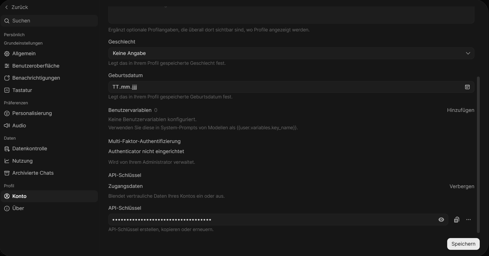

# Vorbereitung auf den Workshop

Bitte erledige diese Schritte **vor dem Workshop**, am besten mit einer guten
Internetverbindung: Es werden insgesamt etwa 1,5 GB heruntergeladen. Das
dauert rund 20–30 Minuten. Am Workshop-Tag geht die Einrichtung dann schnell.

## 1. Rechner

- Mac, oder Windows mit **WSL2** (Linux unter Windows).
- Windows: Falls WSL2 noch fehlt, einfach aus dem Unternehmensportal installieren.

  **Alle folgenden Befehle laufen im Terminal des WSL**, nicht in PowerShell oder CMD.

## 2. Deinen b.chat API-key heraussuchen

b.chat öffnen unter chat.btelligent.com. In der Seitenleiste links unten auf den eigenen Usernamen klicken.
Es öffnet sich ein Popupmenü, dort auf "Einstellungen" klicken, dann auf "Konto". Scrollt ganz nach unten, dann sollte es so aussehen wie auf dem Screenshot unten. Nun bei "Zugangsdaten" auf "anzeigen" klicken und den API-Schlüssel herauskopieren und in Keepass o.ä. sichern, so dass ihr ihn beim Workshop zur Hand habt.



## 3. Docker

- Mac: [Docker Desktop](https://www.docker.com/products/docker-desktop/) installieren und starten.
- Windows: Docker Engine direkt in WSL installieren (siehe unten).
- Test:

```bash
  docker run --rm hello-world
  docker compose version
```

### Docker Engine in WSL installieren

Die Schritte gelten für Ubuntu, die Standard-Distribution von WSL. Ist auf
deinem Rechner schon Docker Desktop mit WSL-Integration installiert, brauchst
du sie nicht.

1. **systemd prüfen.** Docker wird in WSL über systemd gestartet:

```bash
   systemctl is-system-running
```

   Erscheint `running` oder `degraded`, ist alles gut. Erscheint eine
   Fehlermeldung („System has not been booted with systemd …“), systemd
   einschalten:

```bash
   printf '[boot]\nsystemd=true\n' | sudo tee -a /etc/wsl.conf
```

   Im Fall einer solchen Fehlermeldung (und nur dann) WSL neu starten: 
   in einer PowerShell (die einzige Ausnahme von der Regel oben) 
   `wsl --shutdown` ausführen und das WSL-Terminal neu öffnen.

2. **Docker installieren.** Das offizielle Installationsskript richtet die
   Docker-Paketquelle ein und installiert Docker Engine samt Compose:

```bash
   curl -fsSL https://get.docker.com | sudo sh
```

   Wer das Skript nicht verwenden möchte, findet die einzelnen Schritte in der
   [Docker-Anleitung für Ubuntu](https://docs.docker.com/engine/install/ubuntu/).

3. **Docker beim Start von WSL automatisch starten:**

```bash
   sudo systemctl enable --now docker
```

4. **Docker ohne `sudo` nutzen.** Deinen Benutzer zur Gruppe `docker`
   hinzufügen:

```bash
   sudo usermod -aG docker $USER
```

   Danach **alle WSL-Terminals schließen und ein neues öffnen**; die
   Gruppenmitgliedschaft gilt erst ab dann. Ohne diesen Schritt meldet Docker
   „permission denied“.

5. Den Test von oben ausführen.

## 4. uv

[uv](https://docs.astral.sh/uv/) installiert Python und alle Pakete für den
Workshop. Python selbst musst du **nicht** installieren.

```bash
curl -LsSf https://astral.sh/uv/install.sh | sh
```

Danach ein neues Terminal öffnen und prüfen:

```bash
uv --version
```

Auf dem Mac geht auch `brew install uv`. 

## 5. Workshop-Repository

Das Repository liegt öffentlich auf GitHub; ein GitHub-Konto brauchst du
nicht. Du lädst es mit git herunter (unten steht wie's geht). In WSL ist 
git schon installiert; auf dem Mac bietet der erste Aufruf von `git` an, 
die Command Line Tools zu installieren (ein Klick). Prüfen:

```bash
git --version
```

Repository holen (unter Windows im WSL-Terminal, damit es im
WSL-Dateisystem landet):

```bash
mkdir -p ~/repos && cd ~/repos
git clone https://github.com/Allgoerithm/tjf-evolve-participants.git
cd tjf-evolve-participants
```

Dann im Repository-Ordner:

```bash
uv sync                  # lädt Python und alle Pakete
docker compose pull      # lädt das OpenSearch-Image (ca. 1 GB)
```

Kurz vor dem Workshop bitte einmal `git pull` im Repository-Ordner
ausführen, damit du den neuesten Stand hast.

Falls es bei dir gar nicht geht: Auf der GitHub-Seite
<https://github.com/Allgoerithm/tjf-evolve-participants> gibt es unter
„Code“ → „Download ZIP“ das Repository als Zip-Datei. Unter Windows die Datei
dann im WSL-Terminal nach `~/repos` entpacken, nicht im Windows-Explorer.
Die erste Zeile installiert `unzip`; ist es schon da, ändert sie nichts:

```bash
sudo apt install -y unzip
mkdir -p ~/repos && cd ~/repos
unzip /mnt/c/Users/<NAME>/Downloads/tjf-evolve-participants-main.zip
mv tjf-evolve-participants-main tjf-evolve-participants
cd tjf-evolve-participants
```

`<NAME>` ist dein Windows-Benutzername. Danach weiter mit `uv sync` und
`docker compose pull` wie oben.

## 6. Kurzer Test (optional)

Im Repository-Ordner:

```bash
docker compose up -d --wait     # startet OpenSearch
docker compose down             # stoppt es wieder
```

Läuft beides ohne Fehler, bist du startklar.

## 7. VS Code installieren (optional)

Wer schon mit der WSL vertraut ist und eine andere Lieblings-IDE hat, kann selbstverständlich
die benutzen. Allen anderen sei Visual Studio Code empfohlen; damit kann man sowohl Markdown-Files rendern
als auch Prompts komfortabel editieren. Es lässt sich bequem aus dem Microsoft-Store installieren.

Alles Weitere, was dann erst im Workshop wichtig wird, steht in `participant_instructions.md`.
